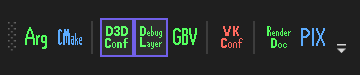
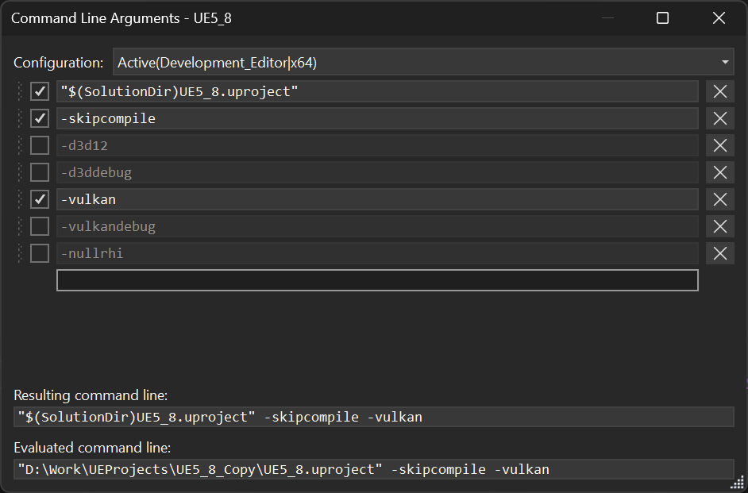

# Graphics Dev Toolbar

A Visual Studio 2022+ extension that adds a **Graphics Dev** toolbar (View > Toolbars > Graphics Dev). The buttons act on the current C++ startup project. A button is grayed out when it can't be used, and its tooltip says why.



| Button | What it does |
|---|---|
| **Arguments** | Edits the debugger command line arguments as a list of lines, each of which can be turned on or off, for one configuration or all of them. |
| **CMake** | Re-runs the CMake configure step by building `ZERO_CHECK`. |
| **D3D Override** | Adds the startup executable to the d3dconfig app list, or removes it. |
| **Debug Layer** | Forces the D3D12 debug layer on, or returns it to app-controlled. |
| **GBV** | Forces D3D12 GPU-based validation on, or returns it to app-controlled. |
| **Vulkan Configurator** | Opens Vulkan Configurator from the newest installed Vulkan SDK. |
| **RenderDoc** | Builds the project and opens RenderDoc with its executable, working directory, arguments and environment filled in. |
| **PIX** | Builds the project and opens PIX with the same launch settings. |

Notes:
- The d3dconfig debug layer and GBV settings are global: they apply to every app in the d3dconfig list. The toolbar reads d3dconfig state when the solution, startup project, or configuration changes.
- PIX reads its launch settings only when it starts, so the toolbar asks you to close a running PIX first.
- Tools are detected when Visual Studio starts.
- Activity is logged to the **Graphics Dev Toolbar** pane of the Output window.

## Command line arguments

The **Arguments** button opens a window that edits the startup project's debugger command line arguments as a list of lines. The enabled lines are trimmed and joined with spaces, and the result is the command line the debugger passes to the program.



- **Turn a line on or off** with its checkbox. A disabled line stays in the list but isn't passed, so you can keep alternative options at hand and switch between them with one click.
- **Add a line** by typing in the blank line at the bottom. A new blank line always appears below it. Enter moves to the next line, Up and Down move between lines, and Backspace on an empty line goes back to the previous one.
- **Remove a line** with its remove button, or by clearing it and moving away.
- **Reorder lines** by dragging them by the grip on the left.
- **Pick the configuration** at the top: the active one, a specific one, or **All Configurations**.
- Below the lines, the window shows the **resulting command line**, and also the **evaluated command line** when there are variables to evaluate.

### Where the lines are saved

Argument lines are saved per project and configuration in `%LOCALAPPDATA%\GraphicsDevToolbar\arguments.json`, so they survive regenerating the project. There's an option in `Tools > Options > Graphics Dev Toolbar` that re-applies them whenever a project loads. This is off by default, because it overwrites the project's current arguments. If by using this option you overwrote arguments by mistake, you can find previous arguments logged to the output pane.

## Building

Requirements: Visual Studio 2022 (17.0+) with the **Visual Studio extension development** workload, or Build Tools with MSBuild and the Visual Studio SDK.

To build, run the packaging script:

```
./scripts/package.ps1
```

This places the resulting .vsix into `artifacts/GraphicsDevToolbar.vsix`.

Alternatively, build `GraphicsDevToolbar.sln` with MSBuild.

## License

MIT. See [LICENSE.txt](LICENSE.txt).
